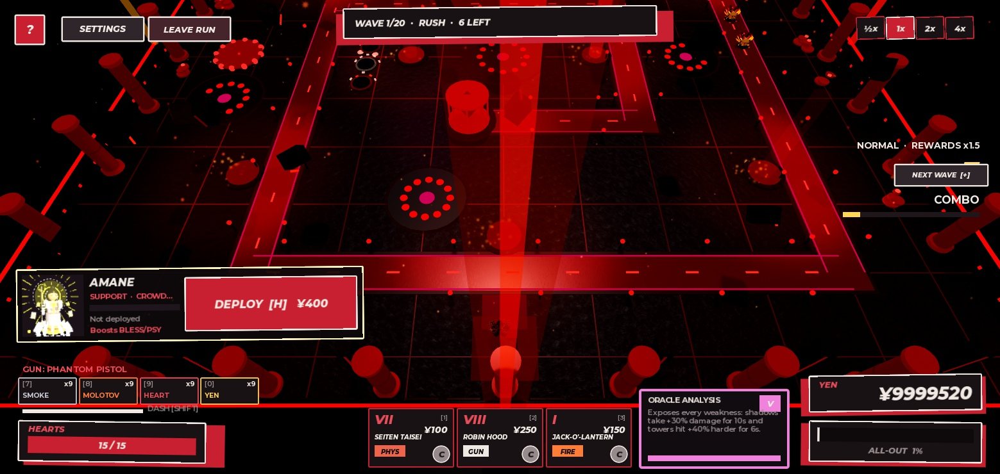
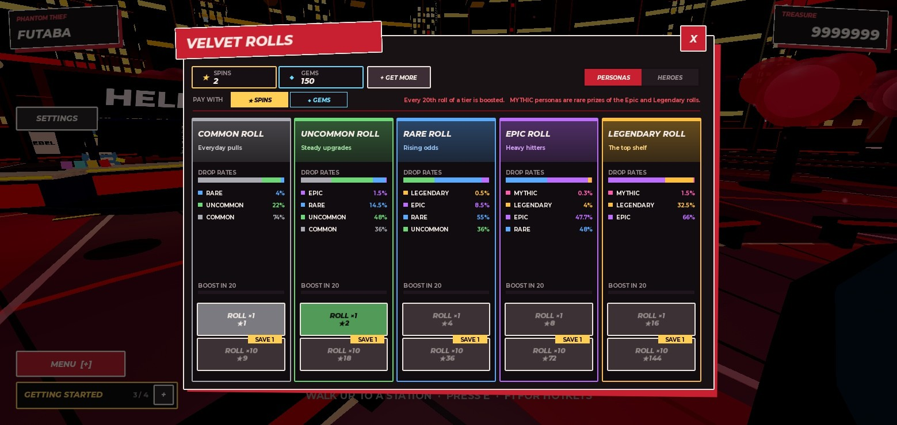
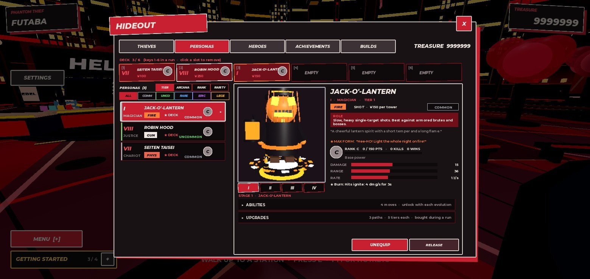
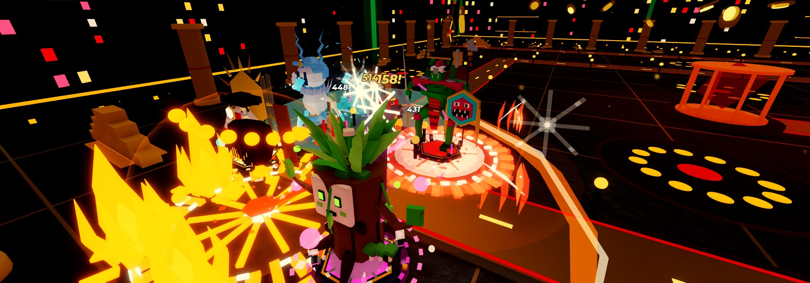
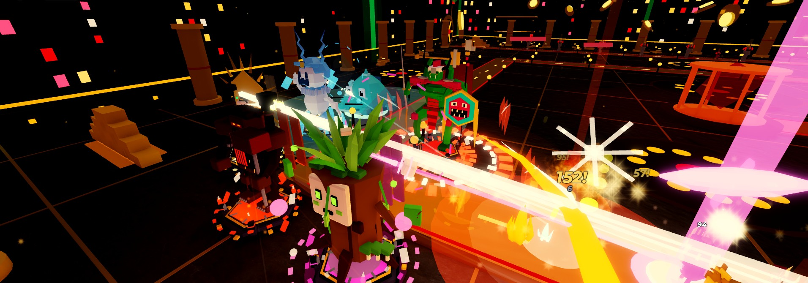
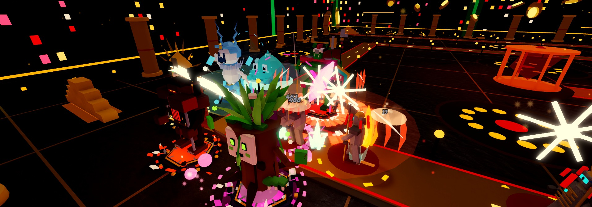
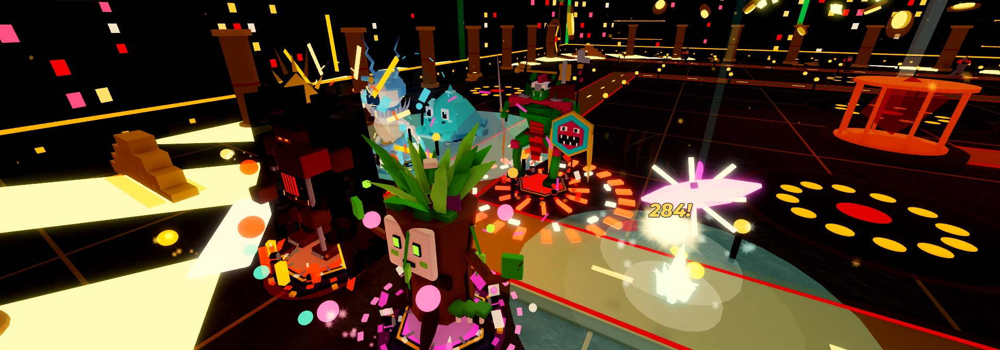
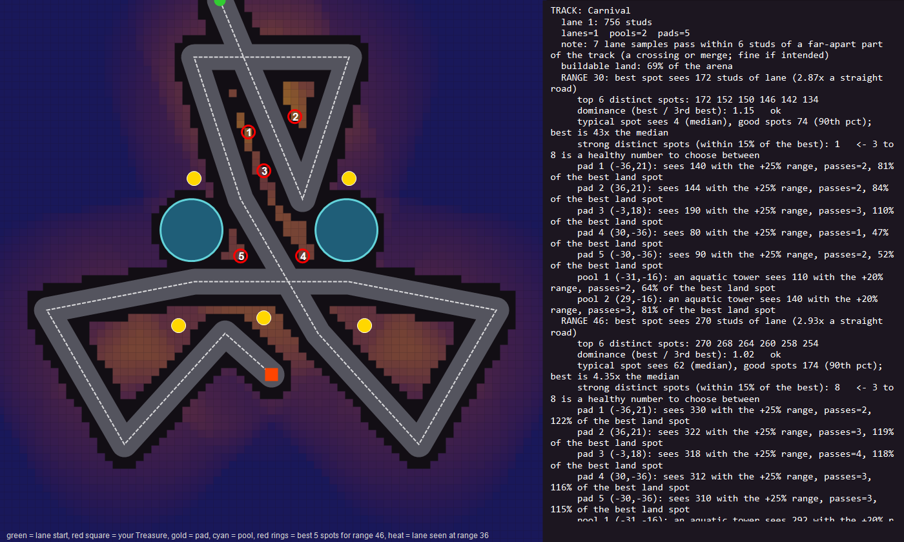
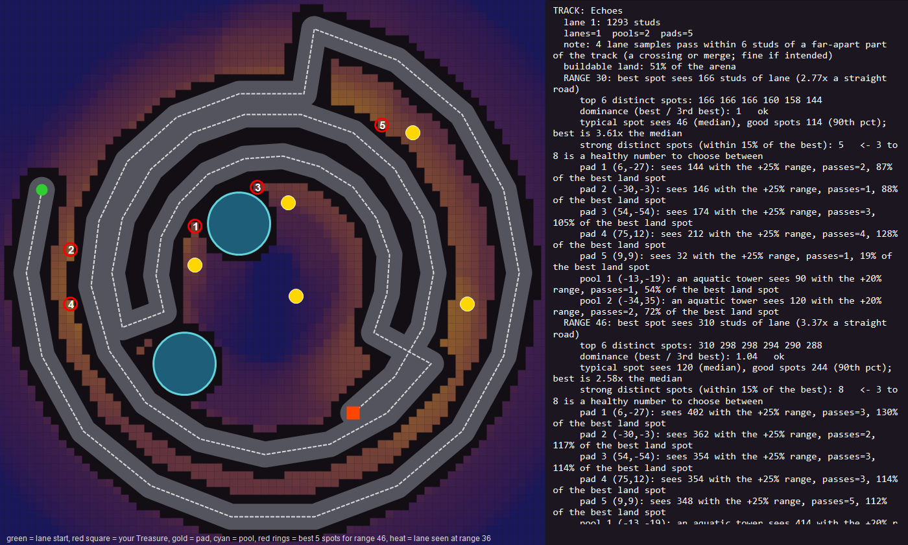
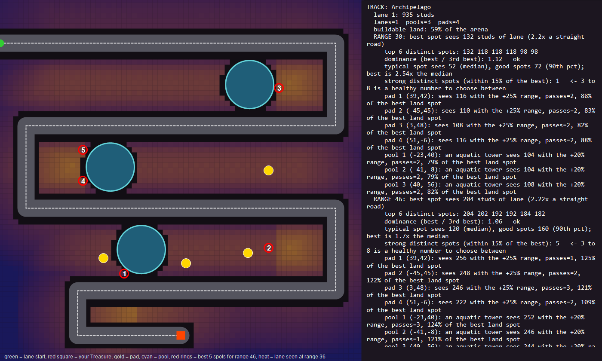

# Phantom Defenders

A Persona-5-inspired multiplayer tower-defense game I built on Roblox (Luau). This repo is a write-up and the tooling I wrote for it. The game's source scripts are not included.

> Built with AI-assisted coding tools. I directed the design, tested it, tuned it from playtester feedback, and wrote the analysis tooling below.

## Screenshots

*A run in progress: tower hit effects, the next-wave card, and the thief active-ability button (bottom right).*

*The roll screen with live drop rates per tier.*

*Hideout: deck, persona details, upgrade paths.*

### Tower and ability effects

The effects were reworked so every persona and ability has its own look (Blender-made meshes plus Roblox particle effects).

*Six towers firing in the Vault of Greed: a fire burst, an ice aura and a critical hit, all on the same lane.*

*A beam volley and a pink pulse crossing the road while a swarm closes in.*

*Melee towers and the player's own attack landing in the same wave.*

*A heal ring, a pink slash and a crit number during a later wave.*

## What it is
- 15 levels ("Palaces"), each with its own map, boss, enemy mix, and rule modifier.
- 9 playable characters ("Phantom Thieves"), each with a passive and a special active ability.
- About 70 collectible towers ("Personas") with branching upgrade paths, evolutions, fusion, rolls, and rarity tiers.
- Solo and co-op, plus a rival 1v1 / 2v2 mode.
- Progression: quests, daily rewards, mastery levels, confidant bonds, titles, challenges, Endless mode with leaderboards.

## Engineering highlights
- **Server-authoritative simulation:** the server runs enemies, towers, abilities, status effects, and boss phases; the client only renders and sends requests.
- **Data-driven balance:** compared enemy health against income across all 15 levels to find difficulty spikes, then tuned multipliers from playtester feedback.
- **Analytics:** onboarding funnel and run events (start, end, wave reached, quits) to see where new players drop off.
- **Security review:** audited all 42 server remotes for input validation; fixed cases where a modified client could send NaN or out-of-range coordinates and amounts.
- **Level design tooling:** a PowerShell + embedded C# analyzer that measures how much of an enemy path each tower position covers, used to compare track layouts before building them (see `tools/`).
- **Persistence:** player data with save retries and session locking.

## Level analysis tool
`tools/palace_designer.ps1` takes a lane (list of waypoints), candidate pools and pads, and reports tower coverage at several ranges, clusters of strong distinct spots, and warnings, then renders a PNG. `tools/design_final_three.ps1` uses it to produce the final layouts for three levels.

Example output (lane in red, high-coverage spots highlighted):

## Balance bot
`tools/balance_bot.lua` is a Studio-only test bot that plays the palaces for me: it picks a deck, places towers on the best-covered spots, upgrades, shoots, uses the hero and thief abilities, answers the post-boss interrogation, and records lives per wave, yen earned and yen spent. Run it with a plan of palaces and read the results back; `tools/balance_bot_results.md` has the tables from the overnight tuning passes.

What it found: two palaces (Despair and Doubt) were unwinnable even at low enemy health because their two lanes sat about 80 studs apart, so no tower could cover both. Pulling the lanes together fixed it, and enemy health could then be tuned per palace until a full-spend run wins with a few hearts to spare.

## Tech
Luau (Roblox), PowerShell, C# (embedded in PowerShell), Roblox Studio.

## Status
In active development and currently private while it is being playtested.
